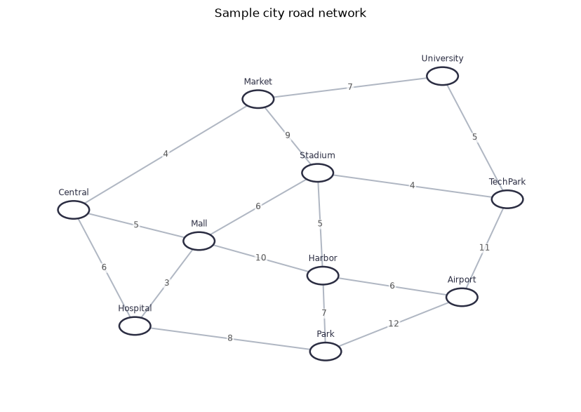
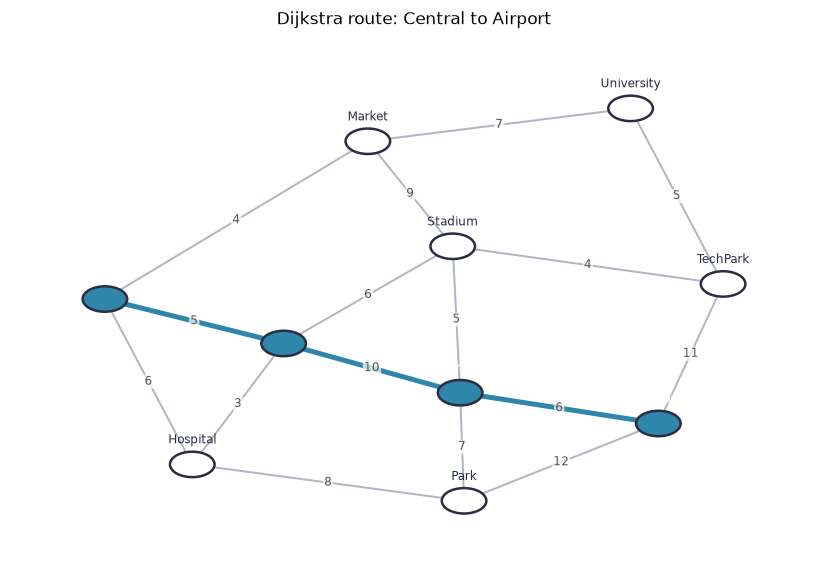
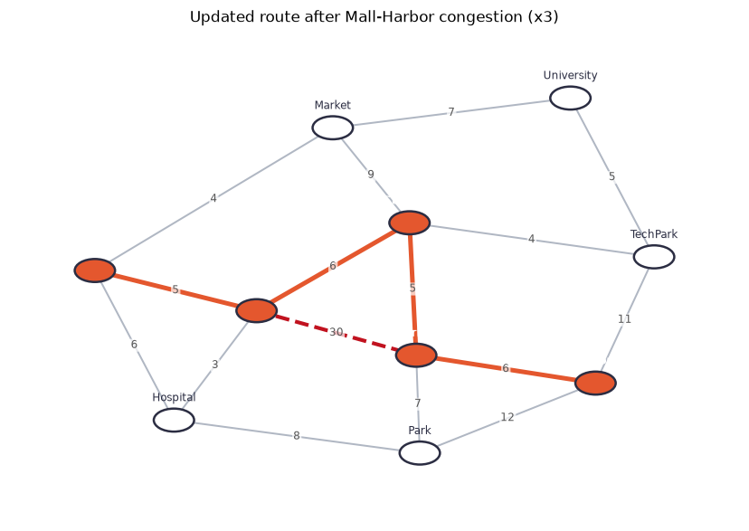
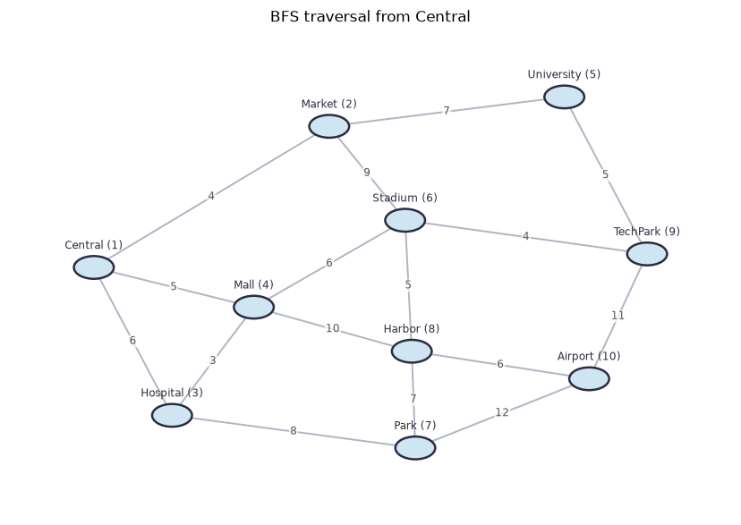
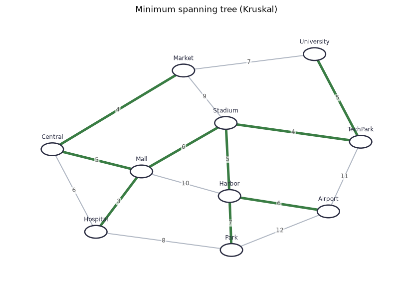
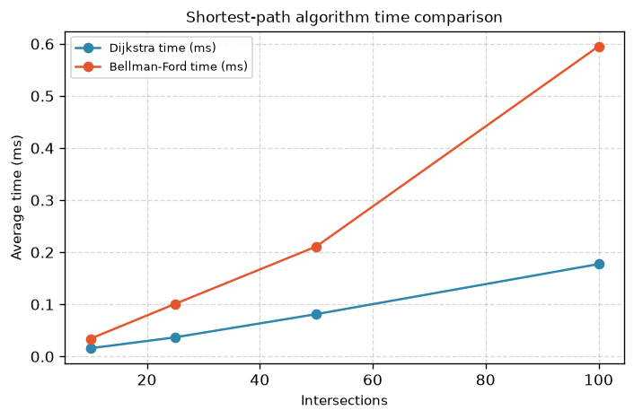

# Smart City Traffic Management and Route Optimization System

A university capstone project for ENCA351, Design and Analysis of Algorithms Lab, BCA (AI and Data Science), Semester V, Session 2026-27, K.R. Mangalam University. The project models a city road network as a weighted undirected graph and applies six graph algorithms: Dijkstra, Bellman-Ford, BFS, DFS, Prim, and Kruskal. All algorithms are implemented from scratch in Python. Results are presented in an interactive Streamlit web application.

**Student:** Kshitij | **Faculty:** Dr. Aarti

---

## Features by module

- **road_network.py**: Models the city as a weighted undirected graph (RoadNetwork class). Supports adding, updating, and removing intersections and roads. Exports adjacency list and adjacency matrix as pandas DataFrames.
- **route_planner.py**: Implements Dijkstra's algorithm with a binary min-heap to find shortest travel-time routes. Returns step-by-step distance updates for inspection.
- **traffic_analysis.py**: Implements Bellman-Ford to model congestion. Applies weight multipliers and road closures, then compares original and updated routes including an intersection-level impact table.
- **connectivity_module.py**: Implements iterative BFS (queue) and DFS (stack) to report reachable and unreachable intersections from any starting point.
- **mst_planner.py**: Implements Prim (min-heap) and Kruskal (Union-Find with path compression and union by rank) to find the minimum spanning tree or forest for infrastructure planning.

---

## Algorithms and complexities

| Algorithm | Time complexity | Best used for |
|---|---|---|
| BFS | O(V + E) | Fewest roads and level-by-level exploration. |
| DFS | O(V + E) | Deep exploration and reachability checks. |
| Dijkstra (binary heap) | O((V + E) log V) | Fast routing with non-negative travel costs. |
| Bellman-Ford | O(V * E) | Networks that may contain negative adjustments, and detecting negative cycles. |
| Prim (binary heap) | O(E log V) | Connected networks, grows one tree outward. |
| Kruskal | O(E log E) | Sparse networks, works edge by edge and handles forests. |

---

## Project structure

```
smart-city-traffic-system-kshitij/
  app.py                  Streamlit web application (six pages)
  road_network.py         RoadNetwork class and CSV I/O functions
  route_planner.py        Dijkstra shortest-path implementation
  traffic_analysis.py     Bellman-Ford and congestion modelling
  connectivity_module.py  BFS and DFS traversal implementations
  mst_planner.py          Prim and Kruskal MST implementations
  benchmark.py            Timing and memory benchmarks, COMPLEXITY_TABLE
  viz.py                  NetworkX layout and Matplotlib drawing helpers
  project_notebook.ipynb  Executed Jupyter notebook with outputs
  requirements.txt        Exact package versions (pip install -r requirements.txt)
  README.md               This file
  .gitignore              Excludes venv, pycache, generated outputs, and secrets
  .streamlit/config.toml  Streamlit theme (light, #2E86AB accent)
  data/sample_city.csv    10-intersection sample city data
  screenshots/            Six output screenshots (one per app page)
  report/                 DAA_Capstone_Assignment_Kshitij_2401201021.docx/.pdf
```

---

## Setup

```bash
# Clone the repository
git clone https://github.com/BeastBoom/smart-city-traffic-system-kshitij.git
cd smart-city-traffic-system-kshitij

# Create a virtual environment
python -m venv venv

# Activate (Windows)
venv\Scripts\activate

# Activate (macOS or Linux)
source venv/bin/activate

# Install dependencies
pip install -r requirements.txt
```

---

## Run

```bash
# Start the Streamlit app
streamlit run app.py

# Execute the notebook (requires venv kernel to be installed)
venv\Scripts\python -m ipykernel install --user --name smart-city-venv
jupyter nbconvert --to notebook --execute project_notebook.ipynb --inplace --ExecutePreprocessor.kernel_name=smart-city-venv
```

The final project report is already generated and committed as
`report/DAA_Capstone_Assignment_Kshitij_2401201021.docx` (Word) and
`report/DAA_Capstone_Assignment_Kshitij_2401201021.pdf` (PDF).

---

## How to use each page

**Road network:** Load the sample city, a random network, or upload your own CSV. Add intersections and roads interactively and view the adjacency list, adjacency matrix, and road list.

**Route planning:** Select a source and destination to find the shortest route using Dijkstra. Inspect the distance-update log and final distances from the source.

**Traffic analysis:** Add congestion multipliers or road closures using the editor, then compare original and updated routes side by side. The impact table shows how every intersection is affected.

**Network connectivity:** Select a starting intersection to run BFS and DFS. View traversal orders, reachable and unreachable intersection counts, and colour-coded network drawings.

**Infrastructure planning:** Run Prim and Kruskal to find the minimum spanning tree. Both results are displayed with costs and highlighted road selections, and the tool confirms when totals match.

**Comparative analysis:** Run benchmarks for network sizes 10, 25, 50, and 100. View timing and memory tables and line charts comparing BFS vs DFS, Dijkstra vs Bellman-Ford, and Prim vs Kruskal.

---

## Sample results

All values below come from running the code on the sample city (10 intersections, 16 roads):

- **Dijkstra, Central to Airport:** Central -> Mall -> Harbor -> Airport, cost 21 min.
- **After Mall-Harbor congestion (x3):** Central -> Mall -> Stadium -> Harbor -> Airport, cost 22 min (delta: +1 min).
- **BFS from Central:** Central > Market > Hospital > Mall > University > Stadium > Park > Harbor > TechPark > Airport.
- **DFS from Central:** Central > Market > University > TechPark > Stadium > Mall > Hospital > Park > Harbor > Airport.
- **MST total (Prim and Kruskal):** 45 min across 9 roads.

Benchmark summary (20 repeats, seed 42):

| Intersections | Dijkstra time (ms) | Bellman-Ford time (ms) | Prim time (ms) | Kruskal time (ms) |
|---|---|---|---|---|
| 10 | 0.0123 | 0.0275 | 0.0101 | 0.0145 |
| 25 | 0.0301 | 0.0760 | 0.0246 | 0.0335 |
| 50 | 0.0991 | 0.1589 | 0.0536 | 0.0691 |
| 100 | 0.1408 | 0.4849 | 0.1444 | 0.1653 |

---

## Screenshots

After running the app, save screenshots to the `screenshots/` directory:








---

## Assumptions

- Roads are two-way (undirected edges with the same weight in both directions).
- All weights are positive numbers representing travel time in minutes.
- A value of 0 in the adjacency matrix means no road exists (not zero travel time).
- Neighbor order follows Python dict insertion order, which is the order of CSV rows.
- Random networks use a road count equal to approximately 1.5 times the number of intersections to ensure a sparse but non-trivial structure.

---

## References and academic integrity

This is individual work by Kshitij. All algorithms are implemented from scratch without calling graph algorithm functions from external libraries. The following sources were consulted: Cormen, Leiserson, Rivest and Stein, *Introduction to Algorithms*, 4th edition, MIT Press 2022; NetworkX documentation (https://networkx.org); Streamlit documentation (https://docs.streamlit.io); Matplotlib documentation (https://matplotlib.org); pandas documentation (https://pandas.pydata.org). NetworkX is used only for spring layout and as an independent test oracle.
